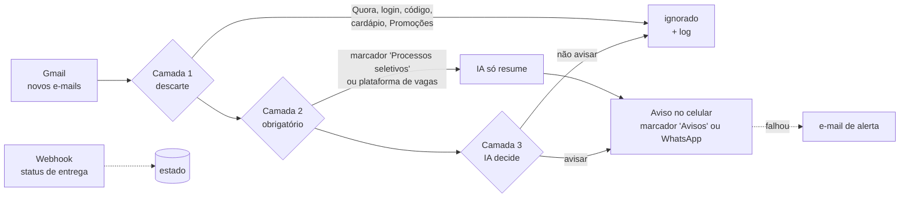

# Agente de Emails 📬 → 🔔

> Um agente que lê meu Gmail a cada 10 minutos, joga fora o ruído, usa uma IA para julgar o que sobra e faz o celular tocar só para o que importa.
> *An email-triage agent: Gmail → rules + LLM (Groq) → phone alert (Gmail label or WhatsApp). Runs free, 24/7, on Google Apps Script.*

Minha caixa de entrada tem milhares de e-mails não lidos (Quora, cardápio do bandejão, código de login...) e no meio deles chegam coisas que não posso perder: convite para teste de processo seletivo, nota de prova, professor remarcando aula. Este projeto resolve isso:

```
💼 Processo seletivo: *PwC: teste online liberado*
De: JobConvo
Prazo: 28/10 23:59
```

```
📝 Nota: *Nota G1 de Cálculo II recebida: 7,0*
De: Secretaria CCE
```

## O que ele faz

- **Roda sozinho, com o PC desligado.** Apps Script executa na nuvem do Google a cada 10 min.
- **Funil em 3 camadas:** regras fixas descartam o ruído conhecido, regras fixas garantem os processos seletivos e uma IA decide o resto.
- **O conteúdo decide, não só o remetente:** o sistema de avisos da faculdade manda nota, aula cancelada e "postei exercício de revisão" pelo mesmo endereço. A IA avisa os dois primeiros e cala o terceiro.
- **IA com critério:** uma política escrita (o que avisar e o que não avisar) e exemplos reais. Ela também escreve o resumo da notificação, como em "Nota G1 de \<matéria\> recebida: 7,0".
- **Nunca perde o que importa:** se a IA cair, processos seletivos são avisados mesmo assim; se o canal recusar, o aviso vai por e-mail.
- **Aviso pelo próprio Gmail:** cada aviso vira uma mensagem curta no marcador `Avisos`; no celular só esse marcador toca. Sem app extra, sem segundo número. WhatsApp (Meta ou Green API) continua como opção.
- **Modo teste (shadow):** no começo a IA só registra numa planilha o que *mandaria*. Você confere as decisões e depois liga de verdade.
- **Resumo diário às 8h**, que também funciona como sinal de vida.
- **Comandos pelo WhatsApp** (canal Meta): `status`, `pausar`, `retomar`.
- **Grátis:** Apps Script, Groq (plano free) e Gmail. WhatsApp Cloud API (número de teste) e Green API (plano Developer) também são gratuitos.

## Como funciona



| Arquivo | Papel |
|---|---|
| `src/Main.gs` | Loop principal (`runAgent`): busca, aplica o funil, envia, registra |
| `src/Rules.gs` | Camadas 1 e 2: listas de descarte e de plataformas de recrutamento |
| `src/Classifier.gs` | Camada 3: prompt, esquema JSON e chamada ao Groq |
| `src/GmailAlert.gs` | Canal Gmail: cria a mensagem de aviso no marcador `Avisos` (Gmail API) |
| `src/WhatsApp.gs` | Envio pelo WhatsApp (Cloud API da Meta ou Green API) e escolha do canal |
| `src/Webhook.gs` | Recebe da Meta os status de entrega e os comandos |
| `src/Store.gs` | IDs já processados, estatísticas e planilha de log |
| `src/Digest.gs` | Resumo diário |
| `src/Setup.gs` | `setup()`, testes, simulação e levantamento de remetentes |
| `Listas.gs` (privado) | Suas listas de remetentes prioritários e silenciados; modelo em `docs/Listas.example.gs` |
| `src/Config.gs` | Configuração; segredos ficam fora do código |
| `src/Text.gs` | Funções puras de texto (limpeza, máscara de números) |
| `test/` | Testes locais com Node simulando Gmail, Groq e Meta |

## Decisões de projeto

- **Apps Script em vez de servidor:** grátis, roda com o PC desligado, já tem acesso nativo ao Gmail e não precisa guardar senha do e-mail em lugar nenhum. Limites (conta pessoal): 90 min/dia de gatilhos, 6 min por execução e 20 mil requisições externas por dia. A cada 10 min dá ~144 execuções curtas, bem dentro disso.
- **Regras antes da IA:** o que é óbvio (Quora, código de verificação) não gasta IA nem corre risco de erro. A IA fica só com a zona cinza, o que também mantém o uso dentro do plano grátis do Groq.
- **Processo seletivo é "sempre avisar":** é o caso em que um falso negativo custa caro. Um filtro do Gmail ([docs/gmail-filter.txt](docs/gmail-filter.txt)) marca esses e-mails e o agente trata o marcador como obrigatório. Mesmo se o agente parar, o Gmail continua destacando esses e-mails.
- **Groq + `gpt-oss-120b`:** plano gratuito, rápido, com *Structured Outputs* (esquema JSON estrito). O Groq não treina com os dados enviados e permite ativar Zero Data Retention. Se o 120b falhar, o código tenta o `gpt-oss-20b`; se a resposta vier inválida, ela é descartada e o e-mail é reavaliado na próxima execução.
- **Privacidade:** para a IA vão só remetente, assunto e um trecho de até 600 caracteres, sem histórico de respostas, com links trocados por `[link]` e números longos (CPF, cartão, telefone) mascarados. O conteúdo dos e-mails é tratado como dado, nunca como instrução (proteção contra *prompt injection*).
- **IDs de mensagem em vez de marcadores:** marcador do Gmail vale para a conversa inteira; uma resposta nova numa conversa já marcada passaria despercebida. O agente guarda os IDs das mensagens processadas (com sobreposição de 20 min entre buscas, sem duplicatas).
- **Falhas visíveis:** a Meta pode *aceitar* uma mensagem e não *entregar*. O webhook registra essas falhas, e o agente avisa por e-mail. Depois de 3 erros seguidos, ele também avisa.
- **Sem segredos no código:** tokens e números ficam em *Propriedades do script*.

## Passo a passo para replicar

Tempo estimado: 20 minutos com o canal Gmail (só precisa de uma conta Google). Com WhatsApp, 40 minutos e uma conta no Facebook (Meta) **ou** um segundo número de WhatsApp (Green API).

### 1. Filtro do Gmail (rede de segurança)

Crie o filtro descrito em [docs/gmail-filter.txt](docs/gmail-filter.txt), trocando as empresas pelas suas. No celular, ative a notificação do marcador "Processos seletivos" no app do Gmail.

### 2. IA: chave do Groq

1. Crie uma conta em [console.groq.com](https://console.groq.com) (pode entrar com o Google).
2. Vá em **API Keys > Create API Key** e copie a chave.
3. Recomendado: em **Settings > Data Controls**, ative **Zero Data Retention**.

### 3. Canal de aviso: escolha um

**Opção recomendada: o próprio Gmail (`WA_PROVIDER=gmail`)**

Cada aviso vira uma mensagem curta (assunto = resumo da IA, corpo com remetente, prazo e link para o e-mail original) criada no marcador `Avisos`, fora da caixa de entrada, pela Gmail API (`users.messages.import`). Criar uma mensagem nova, em vez de só marcar o e-mail original, garante a notificação: o app do Gmail notifica mensagem que chega.

1. No editor do Apps Script, em **Serviços > +**, adicione a **Gmail API** (o Google pede para aceitar os termos de uso das APIs).
2. Em **Propriedades do script**, defina `WA_PROVIDER` = `gmail`. Não precisa de `WA_TO` nem de token.
3. Abra o arquivo `GmailAlert.gs` no editor e rode `testGmailAlert`: o marcador `Avisos` é criado com uma mensagem de teste.
4. No app do Gmail do celular: **Configurações > sua conta**. Desligue **Notificações da caixa de entrada**. Em **Gerenciar marcadores > Avisos**, sincronize os últimos 30 dias e ligue **Notificações do marcador** e **Notificar sobre todas as mensagens**.

> Por que não WhatsApp no seu próprio número? Mensagens que você manda para você mesmo nunca notificam no WhatsApp, e serviços como TextMeBot enviam *como* você (dispositivo conectado). Para tocar, o remetente precisa ser outro número: Meta (opção A) ou um segundo chip (opção B).

**Opção A: WhatsApp Cloud API (oficial, da Meta)**

1. Em [developers.facebook.com](https://developers.facebook.com), crie um app do tipo **Business** com o caso de uso **Conectar no WhatsApp**. A Meta cria um portfólio empresarial e um **número de teste** gratuito (90 dias).
2. Em **WhatsApp > Configuração da API**, adicione seu número como destinatário (até 5) e confirme com o código que chega no WhatsApp.
3. **Complete o perfil da empresa** em *business.facebook.com > Configurações > Informações da empresa* (razão social, país, endereço, telefone e site). Sem isso, mensagens para o Brasil falham com o erro 130497 (veja *Problemas comuns*).
4. Crie um template em **WhatsApp Manager > Modelos**, categoria **Utilidade**, idioma **Português (BR)**, nome `aviso_email`, com o corpo:
   ```
   Notificação automática da sua conta de e-mail. Remetente: {{1}}. Assunto: {{2}}. Prazo informado: {{3}}. Abra o Gmail para ver a mensagem completa.
   ```
   Corpo com só uma variável de texto livre tende a ser reclassificado como *Marketing* e rejeitado. Este formato, com três campos, passou como *Utilidade*.
5. Token permanente: em *business.facebook.com > Configurações > Usuários do sistema*, crie um usuário do sistema, atribua a ele o app e a conta do WhatsApp (permissão **Mensagens**) e clique em **Gerar token**. Escolha expiração **Nunca** e as permissões `whatsapp_business_messaging` e `whatsapp_business_management`.
6. O webhook é configurado no passo 5, depois do Apps Script publicado.

**Opção B: Green API (não oficial, sem template e sem janela de 24h)**

1. Crie uma conta em [green-api.com](https://green-api.com) e uma instância do plano **Developer** (grátis, até 3 conversas).
2. Escaneie o QR code com um **segundo** número de WhatsApp (um chip extra ou o WhatsApp Business no mesmo celular). As mensagens vão sair dele para o seu número principal.
3. Anote `apiUrl`, `idInstance` e `apiTokenInstance`.

> A Green API usa o WhatsApp Web por baixo e não é oficial; existe risco (baixo, para poucas mensagens a um único contato) de o WhatsApp bloquear o número secundário. Não use seu número principal nela.

### 4. Apps Script

1. Crie um projeto em [script.google.com](https://script.google.com) e, em **Configurações do projeto**, marque "Mostrar arquivo de manifesto appsscript.json".
2. Crie os arquivos com os mesmos nomes de `src/` e cole o conteúdo, ou use o [clasp](https://github.com/google/clasp): copie `.clasp.json.example` para `.clasp.json`, preencha o `scriptId` e rode `clasp push`.
3. Em **Configurações do projeto > Propriedades do script**, adicione:

   | Propriedade | Valor |
   |---|---|
   | `GROQ_API_KEY` | chave do Groq |
   | `WA_TO` | *(WhatsApp)* seu número só com dígitos e DDI, ex. `5521999998888` |
   | `WA_PROVIDER` | `gmail` (recomendado), `meta` (padrão) ou `greenapi` |
   | `WA_TOKEN` | *(Meta)* token permanente |
   | `WA_PHONE_NUMBER_ID` | *(Meta)* "Identificação do número de telefone" |
   | `WEBHOOK_VERIFY_TOKEN` | *(Meta)* um texto aleatório qualquer |
   | `GREEN_API_URL`, `GREEN_ID_INSTANCE`, `GREEN_API_TOKEN` | *(Green API)* dados da instância |

   Opcionais: `MODE` (`shadow` ou `live`), `RUN_EVERY_MINUTES` (1, 5, 10, 15 ou 30), `DIGEST_HOUR`, `ALERT_EMAIL`, `GROQ_MODEL`.

4. No editor, selecione `testGroq` e clique em **Executar**. Na primeira vez o Google pede autorização (Gmail, Planilhas, requisições externas); como o app é seu e não verificado, clique em *Avançado > Acessar Agente de Emails*.
5. Rode `testWhatsApp` (manda um aviso de teste pelo canal escolhido). Com a Meta, `ok` significa que ela aceitou; confirme que chegou no celular. Se não chegar, rode `showStatus` depois de 1 minuto (precisa do webhook).
6. Rode `dryRunLast24h`: o agente simula as últimas 24h sem enviar nada e grava as decisões na aba **Simulacao** da planilha "Agente de Emails - Log" (no seu Drive). Ajuste `src/Rules.gs` ou o prompt em `src/Classifier.gs` se discordar de algo.
7. Rode `setup`. Ele cria os gatilhos (a cada 10 min e o resumo das 8h), a planilha e o marcador `Agente/Avisado`.

### Opcional: listas de remetentes

Algumas pessoas e sistemas importam mais que outros, mas nem tudo o que eles mandam merece aviso. Um professor que posta "exercícios de revisão" não deve tocar o celular; o mesmo professor cancelando a aula de amanhã deve.

1. Rode `senderReport`. Ele levanta os remetentes dos últimos 120 dias (fora Promoções/Social/Fóruns) e grava na aba **Remetentes**: quantos e-mails cada um mandou, quantos você abriu, quantos o Gmail marcou como importantes e em quantos você respondeu.
2. No editor do Apps Script, crie um arquivo `Listas` com o conteúdo de [docs/Listas.example.gs](docs/Listas.example.gs) e preencha:
   - `LISTA_PRIORITARIA`: sempre passam pela IA (nenhuma regra de descarte os corta) com a dica de remetente importante. **Quem decide se avisa continua sendo o conteúdo.**
   - `LISTA_SILENCIADA`: descartados direto, sem gastar IA (muito volume, você nunca abre).
   - `LISTA_TESTE`: remetentes para o teste do passo 3.

   Esse arquivo tem e-mails de pessoas reais, por isso fica só no Apps Script e não vai para o repositório (`private/` está no `.gitignore`).
3. Rode `simulateSenders`. Ele passa pela IA os e-mails reais desses remetentes (até 40 conversas de cada), sem avisar nem marcar nada, e grava na aba **Teste remetentes** o que teria avisado e por quê. Se o tempo de 6 min acabar, rode de novo: ele continua de onde parou. Para refazer depois de mudar o prompt, apague a aba.

### 5. Webhook (só para a Meta)

1. **Implantar > Nova implantação > App da Web**, com *Executar como: eu* e *Quem pode acessar: qualquer pessoa*. Copie a URL `/exec`.
2. No app da Meta, em **WhatsApp > Configuração > Webhook**, cole a URL e o `WEBHOOK_VERIFY_TOKEN` e clique em **Verificar e salvar**. Depois assine o campo **messages**.
3. Toda vez que mudar o código, edite a implantação e escolha **Nova versão**, senão o webhook continua rodando o código antigo.

### 6. Ligar a IA de verdade

Depois de alguns dias em `shadow`, confira a aba **Log** da planilha. Se as decisões fizerem sentido, mude `MODE` para `live`.

## Uso no dia a dia

- **Marcador `Avisos`** (canal Gmail): só o que a IA decidiu que vale tocar o celular. O resumo diário das 8h chega na caixa de entrada, sem tocar.
- **WhatsApp:** mande `status`, `pausar`, `retomar` ou `ajuda` para o número do bot (só na Meta). Mandar qualquer mensagem também abre a janela de 24h, e os avisos passam a chegar em texto livre, mais legível que o template.
- **Planilha de log:** cada e-mail analisado vira uma linha com a camada, a regra, a decisão, o resumo e o motivo da IA.
- **Marcador `Agente/Avisado`** no Gmail: conversas que viraram notificação.

## Problemas comuns

| Sintoma | Causa e solução |
|---|---|
| Meta aceita, mas não chega; webhook mostra **130497** *"Business account is restricted from messaging users in this country"* | Desde set/2025 a Meta restringe mensagens para o Brasil vindas de empresas novas ou sem perfil completo. Complete as informações da empresa (passo 3A.3) e espere algumas horas. Se continuar, use a Opção B. |
| **131030** *Recipient phone number not in allowed list* | Adicione e confirme seu número como destinatário do número de teste. |
| **131047** *Re-engagement message* | Texto livre fora da janela de 24h. O agente já usa template nesse caso; confira se o template está aprovado. |
| **132001** *Template name does not exist* | Template ainda em análise ou com nome/idioma diferente de `WA_TEMPLATE`/`WA_TEMPLATE_LANG`. |
| **190** *Invalid OAuth access token* | Token temporário expirado. Use o token do usuário do sistema (passo 3A.5). |
| Template rejeitado como Marketing | Use o corpo com três variáveis do passo 3A.4. |
| `Falta a propriedade do script "X"` | Adicione a propriedade em Configurações do projeto. |
| Canal Gmail: `Gmail HTTP 403` *"Gmail API has not been used in project"* | Adicione a Gmail API em Serviços (passo 3). |
| Canal Gmail: a mensagem aparece em `Avisos`, mas o celular não mostra nada | No app do Gmail, confira as notificações do marcador `Avisos` e se a sincronização dele está ligada. |
| Canal Gmail: o aviso chega só na barra, sem som | Celular no Modo Silencioso: o Android cala todas as notificações. Para só os avisos tocarem, use o Não perturbe com exceção para o Gmail. Confira também o som da categoria de notificação do Gmail (segure o dedo no aviso > Mais). |
| Dois testes seguidos não notificam | O Gmail agrupa mensagens de mesmo assunto numa conversa; se ela já foi aberta, a nova chega lida. Use `testGmailAlert` (põe o horário no assunto). |
| WhatsApp chega mas não toca (TextMeBot e parecidos) | Mensagem para o próprio número nunca notifica. Use o canal Gmail ou um remetente diferente. |
| Groq `429` *tokens per minute* | Plano gratuito: 8000 tokens/min no `gpt-oss-120b`, o que dá cerca de 1 lote de 8 e-mails por minuto. O agente espera o tempo pedido e tenta de novo. |

## Limitações

- O número de teste da Meta vale por 90 dias. Depois disso, é preciso registrar um número próprio (que não esteja no WhatsApp) ou migrar para a Green API.
- O Apps Script não expõe cabeçalhos HTTP, então o webhook não valida a assinatura `X-Hub-Signature-256`. Por isso ele só registra diagnóstico e só obedece comandos vindos do seu número.
- A latência é de até 10 minutos (intervalo do gatilho).

## Testes

```bash
npm test
```

Os testes carregam os arquivos `.gs` em um contexto isolado do Node com Gmail, Groq e Meta simulados. Eles cobrem as regras e as listas de remetentes, a limpeza de texto, a validação da resposta da IA (inclusive quando ela pula e-mails), o limite por minuto do Groq, os modos `shadow`/`live`, a IA fora do ar, a recusa do canal, a janela de 24h, a simulação, o limite de avisos por execução, o canal Gmail e os provedores de WhatsApp.

## Licença

MIT
